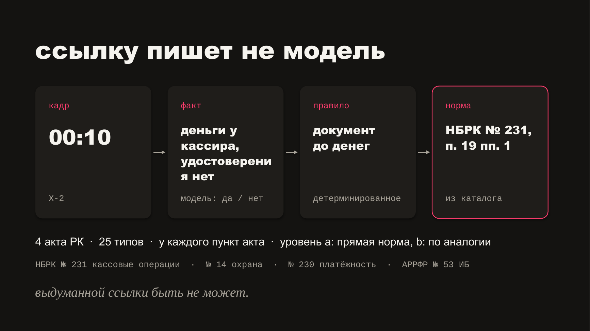
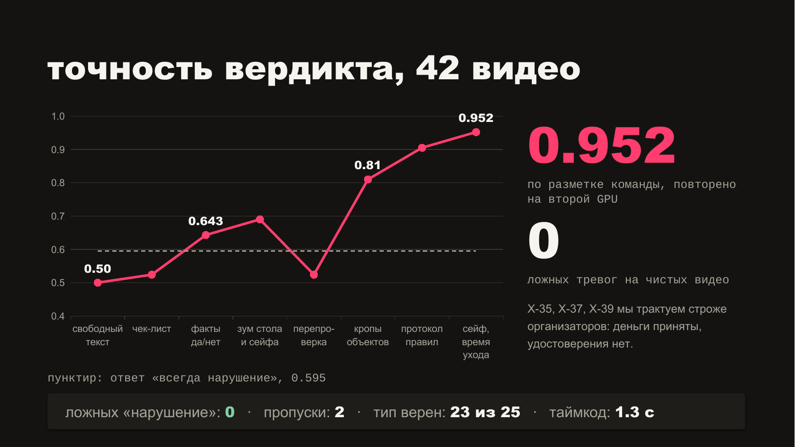
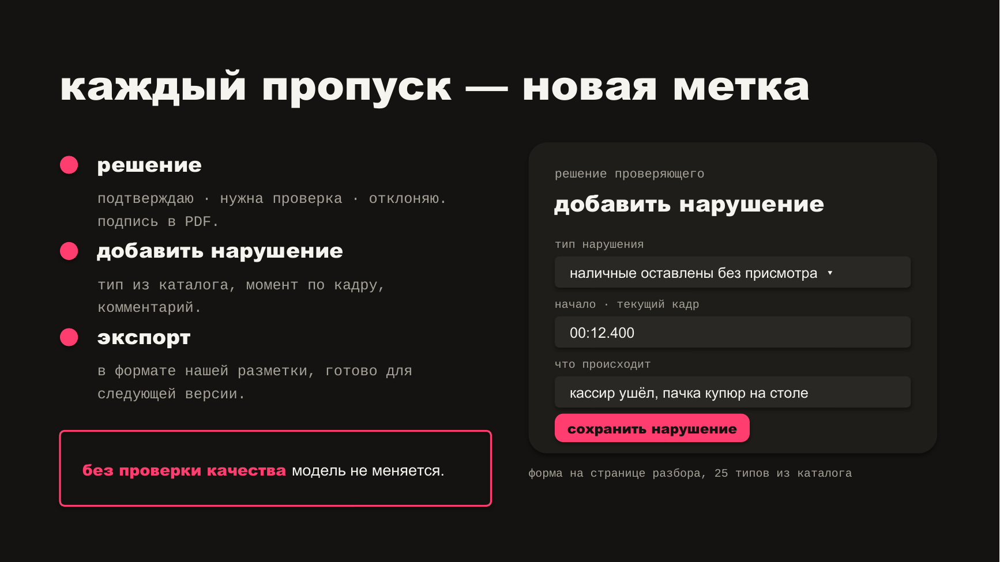

# Forthethon

Forthethon is a local-first AI service that reviews bank-teller video for visible signs of cash-desk procedure violations. It returns a verdict, timestamps, evidence frames, a short explanation, and the relevant rule or regulatory source for human review.

## Datathon 26

This repository is the collaborative result of a three-person team’s participation in **Datathon 26**. It contains the application, research, experiments, and supporting tooling produced for the ForteBank challenge. Team member names and personal details are intentionally omitted from this public version.

## What it does

- Accepts `.mov` and `.mp4` recordings through a web interface or REST API.
- Processes uploads asynchronously and reports job progress.
- Identifies visible events that may require review.
- Shows timestamps and evidence frames for each finding.
- Connects findings to a documented rule catalogue.
- Supports human review and structured review export.
- Includes experimental tooling for video embeddings, object detection, and action classification.

The output is decision support, not a final legal or disciplinary conclusion. Events that cannot be verified from visible evidence should be reviewed by a person.

## Pitch screenshots

These slides from our Datathon 26 presentation show how the service links a video event to a rule, how it performed on the 42 challenge videos, and how a reviewer can correct a missed finding. The evaluation reflects the challenge dataset and is not a measure of performance on new bank footage.







## Architecture

```text
React + TypeScript UI
        |
        v
FastAPI application ---- SQLite job store
        |
        v
Detector adapter ---- local vLLM / vision-language model
```

The production detector is designed to run locally without sending video, frames, or descriptions to cloud AI services. A deterministic stub detector is available for UI and API development without a GPU.

## Run locally

Requirements:

- Python 3.12+
- [`uv`](https://docs.astral.sh/uv/)
- Node.js and npm only when rebuilding the frontend

Install the backend dependencies and start the development service:

```bash
uv sync
uv run uvicorn app.main:create_app --factory --host 127.0.0.1 --port 8000
```

Open <http://127.0.0.1:8000>. With no `DETECTOR` configured, the app uses the stub detector.

To require an API key:

```bash
API_KEY=replace-me uv run uvicorn app.main:create_app --factory --host 127.0.0.1 --port 8000
```

Submit and poll a job through the jury-compatible API:

```bash
curl -X POST http://127.0.0.1:8000/api/v1/analyze \
  -H "X-API-Key: replace-me" \
  -F "file=@sample.mp4"

curl http://127.0.0.1:8000/api/v1/jobs/<job_id> \
  -H "X-API-Key: replace-me"
```

### Docker

Create a local `.env` file containing an API key, then start the service:

```bash
printf 'API_KEY=replace-me\nDETECTOR=stub\n' > .env
docker compose up --build
```

The application will be available at <http://127.0.0.1:8000>.

## Frontend development

The compiled frontend is committed under `app/static/` so the FastAPI service can serve it directly. To modify and rebuild it:

```bash
cd frontend
npm ci
npm run dev

# Production build copied into app/static/
npm run build
```

## Tests

```bash
uv sync --dev
uv run pytest

cd frontend
npm ci
npm test
npm run build
```

## Repository guide

| Path | Purpose |
|---|---|
| `app/` | FastAPI backend, detector integration, job storage, and compiled UI |
| `frontend/` | React and TypeScript frontend source |
| `data/` | Rule catalogue and experiment configuration |
| `docs/research/` | Regulatory research and source mapping |
| `docs/baseline-results/` | Reproducible experiment outputs and metrics |
| `review/` | Local dataset and experiment review interfaces |
| `scripts/` | Dataset preparation, evaluation, and model experiment tooling |
| `tests/` | Backend and workflow tests |

API details are documented in [`docs/api.md`](docs/api.md). Research scope and limitations are described in [`docs/dataset-review.md`](docs/dataset-review.md) and [`docs/embedding-pilot.md`](docs/embedding-pilot.md).

## Data and model weights

Source videos, supplied label spreadsheets, the original challenge brief, and model weights are not committed. Place authorized local dataset files under `assets/` only in a local working copy. Generated review artifacts, uploads, model outputs, and runtime state are ignored by Git.

Some experiments reference third-party model checkpoints with their own licenses. In particular, the recorded VideoMAE materials include non-commercially licensed weights; review every upstream model license before reuse or deployment. The vendored VideoMAEv2 source retains its original MIT license in `scripts/vendor/videomaev2/LICENSE`.

## Licensing

No project-wide license is granted. Unless a file contains its own license notice, the material in this repository may be viewed but not copied, modified, or redistributed without permission from the project contributors. Third-party components remain subject to their respective licenses.

## Project status

This is a Datathon prototype and research artifact. It demonstrates an end-to-end workflow, but production use would require broader validation, security review, privacy controls, model monitoring, and testing on independently collected recordings.
