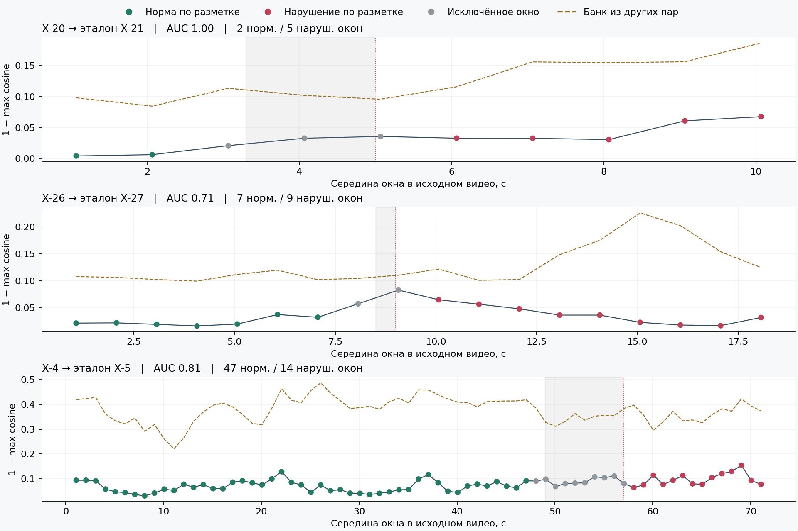
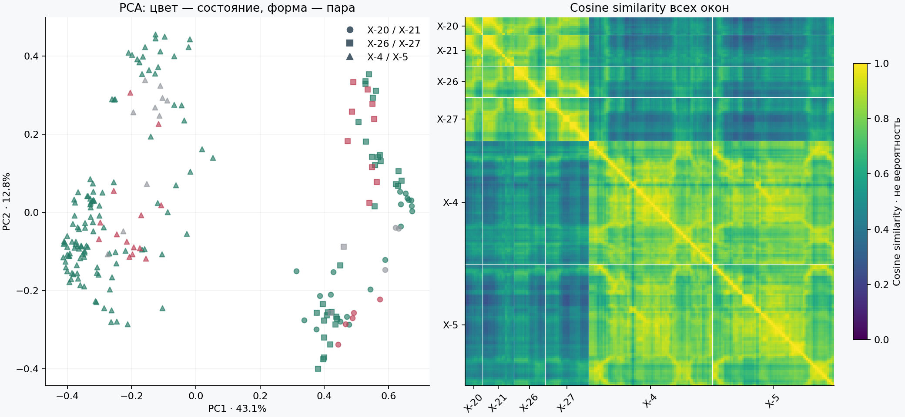

# Локальный эксперимент: три пары видео

Результат запуска 17 октября 2026: признаки помогают искать похожий этап, но расстояние до нормального фрагмента ещё не даёт надёжного признака нарушения. В частности, оставленные деньги почти не меняют вектор пустого помещения, а различие сцен сильно влияет на сходство.

Открыть [интерактивный просмотр](http://127.0.0.1:8766/embeddings.html) при работающем локальном сервере. В нём есть семь сопоставленных эпизодов, поиск ближайшего нормального окна, графики во времени, PCA и матрица сходства. Исходные видео и ручная разметка не изменялись.

## Что посчитано

- 6 исходных видео: X-20/X-21, X-26/X-27, X-4/X-5. Полных дубликатов среди них нет; X-47 и X-48 исключены.
- 212 окон по временной сетке и 14 дополнительных фрагментов для семи сопоставлений: всего 226 MP4 и 226 векторов размерности 1024.
- Длина окна 32/15 ≈ 2.13 с, шаг сетки 1 с. По 32 кадра, ближайших к временной сетке 15 fps, выбираются по реальным PTS исходника.
- Замороженная [Video Swin B, KINETICS400_V1](https://docs.pytorch.org/vision/stable/models/generated/torchvision.models.video.swin3d_b.html). Выходной классификатор заменён на Identity; используются усреднённые признаки перед ним, с L2-нормировкой. Дообучения не было.
- Масштабирование короткой стороны до 256 пикселей и центральная обрезка 224 × 224; нормировка ImageNet. Обрезка и уменьшение выполняются ffmpeg, поэтому интерполяция не полностью тождественна реализации torchvision. Примеры фактического входа доступны под плеерами.
- Вычисление на MPS, torch 2.9.1 / torchvision 0.24.1. Уже имеющиеся локальные веса; видео не отправлялись в сервисы внешнего инференса.

Проверенный SHA-256 весов: `24f7c7c6fd97dd52439d72c2208e0785081811389185a4781405b482404e4b9b`.

## Основная проверка: банк чистой пары

Для каждого окна X-20, X-26 или X-4 берём максимальное cosine similarity со всеми окнами X-21, X-27 или X-5 соответственно. Оценка отклонения равна `1 − max cosine`. Чем она выше, тем меньше сходство с эталоном. Она не является вероятностью нарушения.

AUC рассчитывается только на нормальных и нарушенных окнах проверяемого исходного видео. Окна банка не проверяются сами на себе. Дополнительные 14 сопоставленных фрагментов в AUC и банк не входят. Так нормальные и нарушенные примеры для оценки принадлежат одному исходнику, а не двум разным записям.

| Проверяемое видео → банк | Нормальных окон | Нарушенных | Исключено | ROC-AUC | Медиана отклонения: норма / нарушение |
|---|---:|---:|---:|---:|---:|
| X-20 → X-21 | 2 | 5 | 3 | 1.000 | 0.0053 / 0.0329 |
| X-26 → X-27 | 7 | 9 | 2 | 0.714 | 0.0221 / 0.0369 |
| X-4 → X-5 | 47 | 14 | 10 | 0.815 | 0.0653 / 0.0928 |

AUC 1 означает правильный порядок всех нормальных/нарушенных окон по этой оценке, 0.5 — случайный порядок. Это не accuracy и не качество определения начала нарушения. Соседние окна перекрываются и зависимы; 84 оценённых окна не заменяют 84 независимых видео. Особенно слабое основание для обобщения — всего два нормальных окна X-20.

## Что видно в конкретных эпизодах

| Сопоставление | Окно первого видео, с | Окно чистой пары, с | Cosine |
|---|---|---|---:|
| X-20/X-21: оба достают деньги, нормальный контроль | 1.00–3.13 | 1.00–3.13 | 0.9937 |
| X-20/X-21: пересчёт, сейф открыт / закрыт | 6.00–8.13 | 8.50–10.63 | 0.9418 |
| X-26/X-27: оба пересчитывают, нормальный контроль | 3.00–5.13 | 3.00–5.13 | 0.9831 |
| X-26/X-27: кассир уходит | 9.50–11.63 | 18.20–20.33 | 0.9014 |
| X-26/X-27: кассира нет, деньги оставлены / убраны | 15.00–17.13 | 22.00–24.13 | 0.9815 |
| X-4/X-5: пересчёт первого клиента, нормальный контроль | 20.00–22.13 | 20.00–22.13 | 0.7400 |
| X-4/X-5: приходит второй клиент | 57.50–59.63 | 63.50–65.63 | 0.8848 |

**X-20/X-21:** в выбранных окнах есть разделение, но этот опыт не доказывает, что модель выделила именно дверцу сейфа. Другие движения, позы и фаза пересчёта тоже отличаются.

**X-26/X-27:** отклонение растёт во время ухода, затем уменьшается, хотя нарушение продолжается. В X-26 на 15–17.13 с ближайший эталон — X-27 на 22–24.13 с, где кассира тоже нет, но деньги убраны. Cosine 0.9815 практически совпадает по масштабу с нормальным контрольным пересчётом, 0.9831. Маленькая пачка купюр недостаточно влияет на общий вектор в этом примере.

**X-4/X-5:** AUC 0.815 не означает надёжное обнаружение события на 57 с. Окно 57–59.13 с получает отклонение 0.0641, примерно на уровне медианы нормальных окон 0.0653. Его ближайший эталон — X-5 на 65–67.13 с. Два нормальных эпизода пересчёта на одинаковом таймкоде имеют меньшее сходство, чем сопоставление нормы и нарушения при приходе клиента. Это также показывает чувствительность к фазе действия: ручные интервалы не дают точного выравнивания движений.

## Проверка без эталона целевой пары

Банк составляется только из двух чистых видео других пар. Оба исходника целевой пары из банка полностью исключаются. Дополнительных модельных прогонов для этой проверки не нужно — используются те же векторы.

| Целевая пара | AUC на том же проверяемом видео, как на графике | AUC на обоих исключённых видео | Нормальных / нарушенных окон во втором варианте |
|---|---:|---:|---:|
| X-20/X-21 | 1.000 | 0.720 | 20 / 5 |
| X-26/X-27 | 0.825 | 0.688 | 32 / 9 |
| X-4/X-5 | 0.301 | 0.340 | 117 / 14 |

Первый столбец изолирует влияние замены банка на том же наборе проверяемых окон и отображается в интерфейсе. Второй дополнительно проверяет нормальные действия исключённой чистой записи: для всех её окон вычисляется тот же `1 − max cosine` по банку других пар, затем AUC по обоим видео. Он строже по покрытию нормальных состояний; состав проверяемого набора отличается от основной оценки.

Пример X-26/X-27 объясняет, почему высокий AUC первого варианта может обманывать. Без эталона этой пары пустая комната с оставленными деньгами получает отклонение 0.2025, а нормальная пустая комната — даже немного больше, 0.2087. В обоих случаях ближайший фрагмент — начало X-21. Отсутствие такого нормального состояния в банке повышает оценку независимо от нарушения.

На PCA первая компонента объясняет 43.1%, вторая 12.8% разброса. X-4/X-5 заметно отделяются от остальных четырёх видео, а красные и зелёные точки внутри групп перемешаны. Это согласуется с сильным влиянием сцены/ракурса и этапа действия; само по себе не устанавливает причину каждого различия. Разделение источников на PCA не доказывает OOD-детекцию.

## Как это применить к golden dataset

Банк нормальных фрагментов полезен как поиск аналога и как часть системы. Для следующей версии разумно хранить эталон **этапа и состояния**, а не только один вектор «правильного видео»: пересчёт + дверь сейфа закрыта; уход + стол без наличных; новый клиент + деньги предыдущего убраны.

Этому эксперименту не хватает проверки объектов и памяти о предыдущих шагах. Практический следующий опыт — отдельные области стола/сейфа и контекст до действия, с проверкой на целиком отложенных записях. Банку нужны также разные допустимые порядки действий, паузы и нормальные уходы. Склеенные «исправленные» ролики здесь не создавались: склейка могла бы стать искусственной подсказкой модели.

## Границы разметки и ограничения

- Нормальные префиксы взяты из предоставленного ручного разбора, это кандидаты в golden dataset. Независимой повторной юридической проверки не было.
- X-20: норма до 3.3 с, уверенный нарушенный участок с 5 с. X-26: норма до 8.5 с, нарушение с 9 с. X-4: норма до 49 с, уверенный нарушенный участок с 57 с. Всё окно должно целиком попадать в интервал; остальные окна исключены.
- Поздний правильный пересчёт или проверка документа в X-4 не отменяют оставшиеся деньги предыдущего клиента. Метка относится к состоянию операции, а не к правильности одного движения.
- Центрирование и масштабирование могут скрывать небольшие предметы. Контекст около двух секунд не содержит всю предысторию. Другие модели, области изображения, длинный контекст и дообучение пока не сравнивались.
- Классификатор и порог тревоги не обучались; точность, полнота и задержка боевого детектора не измерены. Перенос на новые камеры и неизвестные нарушения не доказан.
- Запуск занял 648 с, из них около 544 с в модельных прогонах. На части времени одновременно работала вторая копия расчёта, поэтому это не чистый аппаратный бенчмарк. Ограничение итоговой системы в пять минут этим запуском не выполнено.

## Файлы и проверки

Выбор окон: [data/embedding_pilot.json](../data/embedding_pilot.json). Воспроизведение: [README](../README.md#local-video-embedding-pilot).

В `review/generated/embedding-pilot/` сохранены MP4, примеры входа модели, исходные и нормированные векторы, матрица cosine, графики, `run.json` и `results.json` с PTS, хешами источников и результатами. Производные медиа исключены из Git.

Проверены размерность и конечность всех 226 векторов, единичные нормы, соответствие cosine исходным векторам, отсутствие пересечения проверяемого источника с банком, PTS и все файлы. Девять повторно вычисленных одинаковых окон дали совпадающие векторы с допуском 1e-5; длительности 14 сопоставленных MP4 соответствуют выбранным интервалам с точностью одного исходного кадрового интервала. Просмотр и одновременное воспроизведение проверены в браузере.

## Продолжение: текст, участок стола и память — X-26/X-27

17 октября 2026 выполнен отдельный опыт; первый эксперимент выше не изменён. Результаты: `http://127.0.0.1:8766/protocol.html`. На пользовательском `gpu-host` использован имеющийся [CLIP ViT-L/14](https://huggingface.co/openai/clip-vit-large-patch14), ревизия `32bd64288804d66eefd0ccbe215aa642df71cc41`. Это совместный кодировщик изображения и текста; усреднение признаков прошлых кадров не делает его моделью порядка движений. Разметка не передавалась в расчёт признаков.

95 исходных кадров, два в секунду, выбраны по последнему PTS не позже целевого времени. 47 решений: раз в секунду плюс последний кадр каждой записи. Действия оцениваются по среднему нормированных признаков кадров за последние две секунды; деньги и присутствие — по текущему доступному кадру. Для каждой из 14 категорий усреднены два английских текстовых вектора. Все категории доступны на каждом шаге, ожидаемые действия не ограничивают классификацию.

Сцена: `[0,100,384,484]`, участок стола: `[175,360,265,430]` в координатах 464×848. Области выбраны вручную после просмотра этой пары, до получения оценок. Каждый вход масштабируется с сохранением пропорций и дополняется до 224×224. Участок — только 90×70 исходных пикселей; деньги в другом месте не покрываются. Это проверка гипотезы на знакомой камере, не независимый тест детектора денег.

Память хранит подтверждённые наблюдения, без единственной цепочки этапов. Два подряд наблюдения с отрывом cosine ≥0.02 подтверждают действие или состояние. Подтверждённые деньги сохраняются до шести секунд после последнего свидетельства; два уверенных наблюдения пустого участка сбрасывают память. Работа с сейфом не сбрасывает её: это не доказательство, что деньги внутри. История действий и возможные следующие шаги показаны отдельно; они не добавляют неподтверждённые факты в сигнал тревоги. Пропущенное ожидаемое действие само по себе не означает нарушение.

Для численной шкалы применяется softmax с температурой 0.02 отдельно к состояниям стола и присутствия. Это относительная поддержка описаний, не вероятность факта. Без памяти: `min(поддержка денег сейчас, поддержка отсутствия у стола)`. С памятью: тот же минимум, но поддержка денег может сохраняться из подтверждённых наблюдений. Порог тревоги 0.5, температура и отрыв заданы до первого расчёта, не калиброваны по этой паре.

| Вариант | AUC | Найдены / пропущены моменты нарушения | Ложные тревоги / нормальные моменты | Первая тревога |
|---|---:|---:|---:|---|
| Без памяти | 0.9786 | 6 / 6 | 0 / 35 | X-26: 10 с; X-27: нет |
| С памятью | 0.9786 | 6 / 6 | 0 / 35 | X-26: 10 с; X-27: нет |

Ручное начало нарушения X-26 — 9 с. Высокий AUC не означает, что нарушение обнаруживается устойчиво: шесть точек пропущены. Память не изменила ни одной численной оценки: после подтверждения денег сигнал уже устойчив, а минимальное значение часто задаёт слабое распознавание присутствия кассира. В истории X-27 «помещение в сейф» подтверждается лишь в 17 с, когда по ручной разметке уже заканчивается закрытие. Это неверная временная локализация, не подтверждение знания протокола.

Проверка предмета на 15 поздних явно описанных точках (X-26 ≥12.5 с: деньги; X-27 ≥21 с: пустой стол): AUC отрыва «деньги минус лучший альтернативный текст» возрастает с 0.786 на общей сцене до 1.0 на участке. Однако полная классификация четырёх состояний верна лишь на 8/15 участках (2/15 на общей сцене): пустой участок часто путается с закрытым руками. Присутствие у стола распознано top-1 на 17/36 проверяемых точках. На всех 14 точках 1–7 с обеих записей первое действие — «пустое рабочее место», хотя кассир считает деньги. Порог уверенности не спасает от этой систематической ошибки.

Практический вывод: отдельная область помогла ранжировать наличие купюр, но распознавание действий и присутствия недостаточно надёжно. Преимущество памяти на этой паре не показано. Порядок протокола следует описывать обязательствами и условиями: независимые шаги могут переставляться, обязательные проверяются к конкретному событию, а уже возникшее нарушение не исчезает от правильного финала. Эта модель памяти пока проверяет только незакрытое состояние «деньги на участке без кассира», а не весь банковский протокол.

На NVIDIA L4, float32: загрузка модели 10.92 с, тексты 0.64 с, 190 изображений в 95 последовательных обновлениях — 4.19 с forward; медиана после первого обновления — 39 мс за две области. Подготовка входов на сервере заняла 1.66 с; полный вызов inference — 22.30 с. Это не end-to-end задержка камеры: декодирование, SSH, воспроизведение, анализ и вывод в браузер не включены. Новые камеры, перестановки операций и неизвестные нарушения не проверены.

Сохранены исходные PTS, 768-мерные векторы изображений и текстов, все prompts/cosine/состояния, CSV, график, хеши весов, исходных видео, конфигурации и скриптов. Самопроверки проверяют сохранение денег при неясном наблюдении, сброс по пустому участку, истечение свидетельства, отсутствие тревоги при присутствующем кассире и независимость каждого решения от будущего суффикса. Пороги не менялись после просмотра результата.

## Опыт 03: отдельные детекторы денег и присутствия

17 октября 2026, `gpu-host`, NVIDIA L4, float32. Просмотр: `http://127.0.0.1:8766/detections.html`. Использован официальный [Grounding DINO Base](https://huggingface.co/IDEA-Research/grounding-dino-base), ревизия `12bdfa3120f3e7ec7b434d90674b3396eccf88eb`. Один детектор применяется отдельно к людям на полном кадре и к деньгам/рукам/бумаге на столе. Это детектор с текстовыми названиями объектов и рамками, не генеративный ответ о соблюдении протокола. После загрузки весов расчёт офлайн.

Сохранены те же 47 моментов, исходные PTS, все оценки действий CLIP и алгоритм `apply_memory`. Тексты объектов: `person`, `banknotes`, `cash`, `hand`, `paper`. Обнаружения с оценкой ≥0.1 сохраняются, выполняется NMS 0.5 по категории. Оценка категории — максимум sigmoid по токенам её названия, не калиброванная вероятность наличия объекта.

Зона кассира `[125,325,260,525]`: проверяется центр рамки человека. Поэтому видимый человек у двери или за стеклом не считается находящимся у стола. Положительный порог — 0.5; ≤0.2 интерпретируется как отрицательное свидетельство, промежуток — неопределённость. Это эвристика для данной камеры, без установления личности.

Деньги считаются кандидатом на столе, если центр рамки лежит внутри размеченной столешницы и обнаруженная рука перекрывает менее 35% площади рамки. Положительное подтверждение — 0.35. Поддержка линейно масштабируется от 0 при raw score 0.15 до 1 при 0.35. При слабой оценке состояние неопределённо; при низкой оценке и отсутствии обнаруженных перекрывающих рук пустота предполагается. Пропуск детектором денег или рук остаётся возможен: отрицательное свидетельство не доказывает пустоту.

Первый прогон использует область стола `[90,330,350,460]` (260×130). После просмотра его слабых оценок денег проверена область `[175,360,265,430]` (90×70), уже выбранная в прежнем опыте CLIP. Пороги, зона кассира, столешница, текст и память не менялись. Второй масштаб — исследовательская адаптация после просмотра этой пары; это не held-out сравнение. Он не покрывает деньги в других местах стола.

| Вариант | AUC | Найдены / 12 | Пропущены | Ложные / 35 |
|---|---:|---:|---:|---:|
| Прежний CLIP, без памяти | 0.9786 | 6 | 6 | 0 |
| Детекторы, область всего стола | 1.0000 | 3 | 9 | 0 |
| Весь стол + память | 1.0000 | 3 | 9 | 0 |
| Детекторы, крупный участок | 0.9583 | 9 | 3 | 0 |
| Крупный участок + память | 0.9583 | 9 | 3 | 0 |

Во всех вариантах первая тревога X-26 — 10 с; в X-27 тревог нет. Для крупного участка пропущены 9, 13 и 17 с. Порог тревоги 0.5 соответствует более слабому свидетельству, чем строгое подтверждение для памяти, поэтому тревоги могут появляться при неопределённом состоянии предмета. Порог не подбирался по целевой паре.

**Память денег не активировалась ни разу в обоих прогонах.** В широком поле нет ни одного подтверждения ≥0.35; в узком есть одно, на последнем кадре X-26, но нет двух подряд. Поэтому совпадение вариантов не проверяет полезность памяти при надёжных денежных наблюдениях. Оно показывает ограничение текущего детектора/порогов. Калибровать их нужно на других записях; в этом опыте такая калибровка не сделана.

Отдельная проверка наблюдений, одинаковые моменты и бинарный порог поддержки 0.5:

| Наблюдение | Прежний CLIP | Детектор: весь стол | Детектор: участок |
|---|---:|---:|---:|
| Присутствие, 29 явных моментов | 17/29 | 29/29 | 29/29 |
| Присутствие, вся прежняя разметка | 21/36 | 35/36 | 35/36 |
| Деньги, 15 явно описанных поздних моментов | 15/15 | 9/15 | 13/15 |

Здесь бинарное наличие, поэтому значения CLIP отличаются от прежнего top-1 сравнения всех текстовых классов. Полное состояние денег (деньги/пусто/неясно/перекрыто) у детектора верно на 6/15 и 8/15; неопределённых состояний 9 и 7. Точность самих рамок (mAP) не оценивалась: отдельной разметки боксов нет. Кадры 9–10 с находятся около перехода сидит/встаёт/отходит, поэтому грубая разметка начала нарушения и геометрия рабочей зоны могут расходиться; исходные метки сохранены.

Присутствие улучшилось; превосходство детектора денег над CLIP не показано. Более высокий результат итогового порога 9/12 сам по себе не доказывает лучшую переносимость или калибровку. Другие камеры, случаи переноса купюр рукой, несколько людей в зоне и новые нарушения не проверены.

Скорость: 34.96 с для 47 обновлений с широким столом и 33.21 с с крупным участком; два прохода детектора на обновление, подготовка и обработка боксов включены. Загрузка весов и сеть не включены. Признаки CLIP взяты из прошлого запуска; реальная камера и полная онлайн-задержка не тестировались.

Воспроизведение: `scripts/run_detector_pilot.py`, `data/detector_pilot.json`; выходы в `review/generated/detector-pilot/` и `review/generated/detector-pilot-patch/`. Проверяются SHA кадров, конфигурации и подготовленного набора; причинность каждого префикса; тождество всех CLIP action scores прежнему запуску; геометрия стола/зоны; исключение денег, перекрытых рукой; неопределённость слабых рамок. Низкие кандидаты сохранены в JSON и доступны в просмотрщике, чтобы их можно было отличить от подтверждённых наблюдений.

Для следующего сравнения распознавания действий разумно проверить video-only признаки с обучаемой головой на размеченных действиях, разделяя целые видео/пары между обучением и проверкой. Например, [VideoMAE](https://github.com/MCG-NJU/VideoMAE) предоставляет предобучение и дообучение для распознавания действий. Это предложение, а не выполненный эксперимент. Оно не заменяет наблюдение небольших объектов и явные условия протокола; уже проверенный Video Swin дал cosine около 0.98 для пары «ушла, деньги на столе» / «ушла, стол пуст».

## Следующий опыт: замороженный VideoMAE и обучаемые действия

Предложение выше реализовано отдельным опытом `scripts/run_action_pilot.py`, конфигурация — `data/action_pilot.json`, просмотрщик — `review/actions.html`. Предыдущие результаты не заменяются. Расчёт признаков и обучение голов выполняются на пользовательской gpu-host; исходные видео не передаются в сервисы распознавания.

Выбраны шесть наблюдаемых действий: ручной пересчёт, работа со счётной машинкой, ноутбук, работа с документом, работа с сейфом, уход кассира. Это укрупнённые классы: машинка включает загрузку/выгрузку и ожидание счёта, документ — получение/осмотр, сейф — открытие/закрытие/замок/помещение ценностей. Ни один из этих классов сам по себе не доказывает соблюдение протокола. Метки нарушений и законы не используются как признаки или целевые классы.

Сопоставление строк исходной разметки с действиями задано явно, без классификации текста моделью. Длинные смешанные эпизоды, например X-4 «ноутбук и купюры» и X-14 «распаковать, пересчитать, разложить», исключены. Отступ от каждой границы — 0.125 с; это уменьшает, но не устраняет шум грубых временных меток. Окно длится 2 с, шаг 1 с; из одного интервала берётся не более восьми окон, распределённых по доступной сетке. Не выбранные интервалы не становятся отрицательными примерами.

| Выборка | Уникальных видео с окнами | Исходных интервалов | Окон |
|---|---:|---:|---:|
| Обучение | 22 | 35 | 123 |
| Validation для выбора C | 6 | 14 | 37 |
| Финальная проверка | 9 | 20 | 69 |

Test: X-4/X-5, X-26/X-27, X-28/X-29, X-34/X-35/X-37. Validation: X-18/X-19, X-20/X-21, X-22/X-23. Остальные недублирующиеся записи назначены в train; X-17/X-40/X-44 не дают подходящих окон. X-47/X-48 назначены в test вместе с оригиналами, но исключены из нарезки. Связанные пары, включая тройки/четвёрки, и одинаковые SHA исходных файлов не пересекают границы выборок. Разделение и сопоставление действий зафиксированы до расчёта новых признаков.

| Действие | Train | Validation | Test |
|---|---:|---:|---:|
| Ручной пересчёт | 3 | 5 | 18 |
| Счётная машинка | 46 | 6 | 13 |
| Ноутбук | 22 | 13 | 7 |
| Документ | 4 | 2 | 5 |
| Сейф | 34 | 9 | 14 |
| Уход | 14 | 2 | 12 |

Особенно мало обучения для пересчёта и документов. Окна коррелируют, а девять test-видео относятся всего к четырём связанным сценарным группам. Эти записи уже просматривались ранее: это проверка нового обучения с отложенными видео, а не ранее неизвестный внешний тест. Другие камеры и неизвестные действия не оценены.

**Входы и головы.** Обе модели получают строго одинаковые 16 кадров по исходным PTS, без подстановки `frame/30`, равномерно из двухсекундного окна. Кадр целиком уменьшен с сохранением пропорций до 224×224 с полями; центр не обрезается. Нормализация своя у каждой модели. Входы, метки, исходные тексты и временные метки сохранены в `prepared.json` и `inputs/`. На таком масштабе купюры и карточки очень малы.

[VideoMAE-base](https://huggingface.co/MCG-NJU/videomae-base), ревизия `dc740ceda42fce44faed2ea03c6d447db72f6af9`, предварительно обучен самонаблюдением на Kinetics-400; готовая голова Kinetics не используется. Энкодер работает без маски и без декодера; среднее всех 1568 конечных токенов даёт 768 признаков. CLIP ViT-L/14 использует прежнюю закреплённую ревизию; среднее 16 нормированных признаков кадров тоже даёт 768 признаков. Итоговые векторы обеих моделей нормируются. Энкодеры в `eval`, все параметры `requires_grad=False`, расчёт внутри `inference_mode`; обучение головы выполняется отдельно по сохранённым векторам.

Головы одинаковые: многоклассовая logistic regression, 768×6 весов и 6 смещений, балансировка классов. Сетка C = 0.1, 1, 10, 100; выбор по macro F1 на validation, при равенстве — меньшее C. Преобразования, обученные на всех данных, отсутствуют. После выбора C дообучения на validation нет. CLIP с двумя положительными описаниями каждого действия показан отдельно без обучения, чтобы не смешивать эффект новой модели и эффект размеченных примеров.

`features.npz`, `inference.json`, `heads.npz`, `fit.json`, `scores.csv` и графики находятся в `review/generated/action-pilot/`. Хэши связывают исходники, входы, веса, векторы и головы. Проверки отбрасывают разнесённые по выборкам пары/дубликаты, короткие окна и выход за границы разметки. Просмотрщик показывает только test-фрагменты; численные выходы голов не калиброваны. Класса «неизвестно» нет, поэтому произвольный поток видео этим классификатором ещё не оценивается.

### Результат запуска 17 октября 2026

| Модель | Выбранный C | Macro F1 train | Macro F1 validation | Macro F1 test | Верных окон test |
|---|---:|---:|---:|---:|---:|
| VideoMAE + линейная голова | 1 | 0.6392 | 0.2824 | **0.1869** | 18/69 (26.1%) |
| CLIP + линейная голова | 100 | 0.9957 | 0.5682 | **0.3596** | 32/69 (46.4%) |
| CLIP + описания без обучения | — | 0.0619 | 0.0171 | **0.1101** | 15/69 (21.7%) |

Средняя accuracy с равным весом каждого test-видео: 35.0%, 40.4%, 18.2% соответственно. Отличие от общей accuracy связано с разным числом окон в видео; обе оценки доступны в просмотрщике. После просмотра test модель, входной масштаб, C-сетка, разметка и промпты не менялись.

VideoMAE предсказал «машинку» на 54 из 69 test-окон. Для X-26/X-27 все 18 окон получили этот класс: 0/8 и 0/10 верных. Выходы головы близки к равномерным 1/6; это не уверенное распознавание машинки. Обученный CLIP дал 2/8 и 4/10: распознал два окна ухода X-26, три окна работы с сейфом и одно окно ухода X-27. В обеих записях все окна ручного пересчёта перепутаны с машинкой. Эти числа относятся только к выбранным действиям, а не ко всем секундам видео или нарушениям.

На всём test ручной пересчёт распознан в 2/18 окнах каждой обученной моделью, документ — в 0/5. CLIP лучше по сейфу (9/14 против 0/14) и уходу (10/12 против 0/12); VideoMAE лучше по ноутбуку (3/7 против 0/7). Матрицы ошибок важнее одного общего числа: ни один вариант пока не даёт надёжных наблюдений для протокола.

**Интерпретация.** В этой конфигурации замена CLIP на frozen self-supervised VideoMAE не улучшила действия. У VideoMAE усреднённые нормированные признаки мало различаются между фрагментами, а выбранная линейная голова даёт почти одинаковые оценки классов. CLIP почти идеально разделяет обучение, но заметно хуже переносится на другие видео. Нехватка независимых примеров, мелкий масштаб рук/документов, грубая разметка, способ усреднения и регуляризация головы остаются возможными причинами; этот опыт не изолирует их вклад. Он не доказывает непригодность video encoders, пользу временного порядка или результат дообучения самого энкодера.

Следующий обоснованный опыт — улучшить разметку редких действий и видимость рук/предметов, затем отдельно проверить нормализацию признаков, другую голову или дообучение энкодера. Такие изменения после просмотра текущего test нужно считать исследовательскими и подтверждать на новых видео, а не выбирать лучший вариант по этим девяти записям. Деньги на столе, уход и условия протокола по-прежнему требуют отдельных проверок состояния и памяти.

**Скорость и воспроизводимость.** NVIDIA L4, float32, PyTorch 2.7.1+cu128, Transformers 5.19.0. GPU forward для 229 окон: VideoMAE 11.46 с (медиана 49.8 мс), CLIP 81.55 с (357.1 мс). Полные стадии извлечения на сервере — 19.77 и 91.03 с; локальное декодирование и передача файлов не включены. CLIP здесь заново считает все 16 кадров каждого окна, без кеширования пересекающихся кадров; это не оптимизированное сравнение онлайн-скорости. Обе головы обучены scikit-learn 1.7.2 на CPU того же сервера.

Повторное вычисление вероятностей по `features.npz` и `heads.npz` совпало со всеми сохранёнными предсказаниями (229 окон × две головы), отклонение менее 1e-7. Проверены размерности 229×768, конечность и единичная норма векторов, фактические PTS, все изображения входов, хэши и отсутствие утечки пар/дубликатов. Автоматические проверки специально отвергают перенос X-27 или дубликата X-47 в train. Страница проверена с переключением видео, выбором окна и воспроизведением исходного фрагмента.

### Стандартизация сохранённых признаков: только validation

Следующий опыт проверяет гипотезу о масштабе признаков. Скрипт `scripts/run_action_normalization.py` использует исходные сохранённые L2 embeddings. Для каждой модели `StandardScaler` вычисляет среднее и дисперсию каждой координаты только по 123 окнам train; к validation применяется то же преобразование. Дисперсия — population variance (`ddof=0`); постоянные координаты имеют масштаб 1. После стандартизации повторной L2-нормализации нет. Энкодеры, кадры, разметка и разделение не менялись; новые предсказания test не вычислялись.

Голова, балансировка классов и сетка C = 0.1, 1, 10, 100 прежние. Каждый вариант выбирает C по macro F1 на тех же 37 validation-окнах из X-18/X-19, X-20/X-21, X-22/X-23. Это шесть видео, три сценарные группы и 14 размеченных интервалов. Дополнительно сравнивается эффект стандартизации при прежнем C. Результат после выбора C на validation не является независимой оценкой test.

| Модель | F1 до | F1 после при прежнем C | F1 после выбора C | C до → после | Верных окон до → после |
|---|---:|---:|---:|---|---|
| VideoMAE | 0.2824 | 0.3372 | **0.4031** | 1 → 100 | 10/37 → 15/37 |
| CLIP | 0.5682 | 0.6614 | **0.6614** | 100 → 10 | 22/37 → 23/37 |

У CLIP C=10 и C=100 после стандартизации дают одинаковый F1, поэтому выбран меньший. Все результаты сетки показаны на странице `actions.html#normalization` и сохранены в JSON; сетка после просмотра результата не расширялась.

| C | VideoMAE до | VideoMAE после | CLIP до | CLIP после |
|---:|---:|---:|---:|---:|
| 0.1 | 0.1145 | 0.2872 | 0.3535 | 0.6255 |
| 1 | 0.2824 | 0.3372 | 0.2299 | 0.6009 |
| 10 | 0.1174 | 0.3134 | 0.3536 | 0.6614 |
| 100 | 0.1162 | 0.4031 | 0.5682 | 0.6614 |

Гипотеза частично поддержана: масштаб/геометрия признаков и связанная с ними регуляризация влияют на результат. Медианное стандартное отклонение координат на train до преобразования — 0.000833 для VideoMAE и 0.010427 для CLIP. У VideoMAE средний максимум выхода головы на validation вырос с 0.168 до 0.925, однако accuracy только 0.405: увеличение уверенности само по себе не означает правильность или калибровку.

Прирост неодинаков по действиям. У VideoMAE машинка стала распознаваться в 3/6 окон вместо 0/6, сейф — в 9/9 вместо 6/9; ручной пересчёт по-прежнему 0/5, ноутбук 0/13. У CLIP ручной пересчёт улучшился с 0/5 до 3/5, сейф — с 7/9 до 8/9, но машинка ухудшилась с 6/6 до 3/6. Поэтому прирост macro F1 заметнее прироста общей accuracy. После стандартизации обе головы имеют F1=1 на train; разрыв с validation сохраняется.

Расчёт выполнен локально на CPU по готовым векторам, scikit-learn 1.7.2 и NumPy 2.2.6, как в исходном запуске. Проверены хэши исходного набора, признаков, голов и прежних результатов; все baseline validation-предсказания и F1 каждого C воспроизведены. Статистики scaler сверены с train; синтетическая проверка меняет validation на экстремальные значения и подтверждает неизменность средних/масштабов train. Четыре сохранённых конвейера воспроизводят validation-вероятности; исходные артефакты остались неизменными.

Новые артефакты отдельно в `review/generated/action-normalization/`: `pipelines.npz` со средними, масштабами, дисперсиями, числом train-примеров и выбранными головами; `results.json`/`.js`; `scores.csv` только для validation; `validation.png`. Проверка запускается командой `python3 scripts/run_action_normalization.py check`, расчёт — без аргументов. Новая нормализация ещё не проверена на test или новых съёмках.

### Фиксированный кроп рук и рабочего стола: validation

17 октября 2026 проверена гипотеза, что мелкие детали теряются при уменьшении полного кадра. До нового инференса просмотрены только представительные train-кадры; зафиксирован один прямоугольник `[0,240,440,640]` для всех видео (координаты x0,y0,x1,y1 исходника 464×848). Кроп 440×400 увеличивает рабочую область примерно в 1.9 раза относительно полного кадра после масштабирования в 224×224. Он включает руки, стол и часть сейфа, но отсекает часть верхнего и нижнего контекста; это не трекер рук и не универсальная область для других камер.

Использованы прежние 123 train и 37 validation окон, те же 16 исходных кадров и PTS каждого окна. Test не декодировался, не кодировался и не оценивался. Замороженные VideoMAE v1 и CLIP запущены на gpu-host; SHA-256 весов, версии PyTorch/Transformers, модельная нормировка и pooling совпадают с baseline. Чистое время forward: около 8.0 с для VideoMAE и 57.0 с для CLIP на 160 окнах. Линейные головы обучены локально на CPU с прежними NumPy/scikit-learn.

Каждая комбинация encoder/вида получает собственный StandardScaler, обученный только на train. Сохранена сетка C=[0.1,1,10,100], balanced logistic regression, seed и выбор по validation macro-F1; без дообучения на validation и без повторной L2-нормировки после стандартизации. Полный кадр использует прежние embeddings: все его оценки по сетке и выбранные вероятности точно воспроизведены.

| Модель | Вид | C | Train macro-F1 | Validation macro-F1 | Верно / 37 |
|---|---|---:|---:|---:|---:|
| VideoMAE | Полный кадр | 100 | 1.000 | 0.4031 | 15 |
| VideoMAE | Кроп | 100 | 1.000 | 0.4513 | 17 |
| CLIP | Полный кадр | 10 | 1.000 | 0.6614 | 23 |
| CLIP | Кроп | 0.1 | 1.000 | 0.4941 | 22 |

При фиксированном исходном C=10 кроп CLIP даёт ещё ниже: 0.3928. Для VideoMAE C не изменился. Новая сетка validation macro-F1:

| C | VideoMAE crop | CLIP crop |
|---:|---:|---:|
| 0.1 | 0.2872 | 0.4941 |
| 1 | 0.2988 | 0.4638 |
| 10 | 0.2872 | 0.3928 |
| 100 | 0.4513 | 0.4210 |

Число правильно распознанных validation-окон каждого класса (recall numerator, не precision):

| Действие | Всего | VideoMAE full → crop | CLIP full → crop |
|---|---:|---:|---:|
| Ручной пересчёт | 5 | 0 → 0 | 3 → 0 |
| Машинка | 6 | 3 → 4 | 3 → 6 |
| Ноутбук | 13 | 0 → 0 | 5 → 5 |
| Документ | 2 | 1 → 2 | 2 → 0 |
| Сейф | 9 | 9 → 9 | 8 → 9 |
| Уход | 2 | 2 → 2 | 2 → 2 |

Улучшение VideoMAE — два дополнительно правильных окна: документ в X-18 и машинка в X-21. Проблемные ручной пересчёт и ноутбук не улучшились. CLIP теряет редкие классы, хотя машинка/сейф распознаются чаще. Поэтому accuracy меняется лишь на одно окно, а macro-F1 падает значительно.

**Вывод:** этот единственный фиксированный кроп не подтверждает, что простого увеличения деталей достаточно для решения проблемы. Небольшой выигрыш VideoMAE не устраняет разрыв train/validation; CLIP с полным кадром остаётся лучшим из этих вариантов. Потеря контекста, особенности представлений и малое число независимых примеров остаются гипотезами, которые этот опыт не разделяет. Ручной пересчёт имеет только три train-окна, документ — четыре. Результат не исключает пользу другого локального представления или совместного полного/локального вида, но подбирать кроп по этим же validation-ошибкам и считать это независимой проверкой нельзя.

Артефакты: `review/generated/action-crop/` содержит frozen `prepared.json`, входы, embeddings, metadata, scaler/head параметры, `results.json`, 148 строк предсказаний `scores.csv`, график по классам и HTML-отчёт. [Открыть локальное сравнение](http://127.0.0.1:8766/generated/action-crop/report.html). Команды находятся в README. Проверены идентичность split/меток/PTS, исключение test, исходные хеши baseline, train-only статистики и восстановление вероятностей из сохранённых параметров. Выборка validation состоит всего из шести ранее просмотренных видео; окна перекрываются. Это exploratory validation, не оценка OOD или новых съёмок.

### VideoMAEv2 ViT-base distilled K710: полный кадр, validation

17 октября 2026 добавлен официальный [VideoMAEv2 distilled ViT-base K710](https://github.com/OpenGVLab/VideoMAEv2/blob/29eab1e8a588d1b3ec0cdec7b03a86cca491b74b/docs/MODEL_ZOO.md). Выбран до получения validation-результатов: размер base и выход 768 совпадают с v1/CLIP. Это checkpoint `OpenGVLab/VideoMAE2`, ревизия `706cc172d65ebd4dedbee3f9c0183a93df9fa125`, файл `distill/vit_b_k710_dl_from_giant.pth`, SHA-256 `8141a6955e0700d11bf15928fe6d61e5cfe482606fed8cfdddb1b922c0fd88ec`.

**Сравнение pretrained-моделей, не чистый эффект архитектуры:** v2 дистиллирован на K710 от giant teacher, а v1 из baseline имеет только self-supervised K400 pretraining. В v2 использован официальный `forward_features`: среднее финальных patch tokens и learned `fc_norm`, затем наша L2-нормировка. Классификатор K710 не используется для признаков. Входная нормировка ImageNet взята из фактического dataset pipeline upstream, а не generic `_cfg()`.

Официальный исходник сохранён без изменений с MIT-лицензией и закреплённым хешем; commit `29eab1e8a588d1b3ec0cdec7b03a86cca491b74b`. Веса загружены с `weights_only=True`, строгим совпадением всех параметров. Проверены повторяемость encoder и равенство полного выхода модели применению её штатной головы к извлечённому признаку. Это проверяет место извлечения признаков, а не качество классификации на K710. timm 1.0.22 установлен отдельно от существующего окружения GPU. Небольшая правка нашего загрузчика зарегистрировала динамический модуль для timm; upstream-код не менялся.

Побайтно переиспользованы входы полного кадра из original action-pilot: 16 кадров за две секунды, padding до 224×224, реальные PTS, прежние 123 train/37 validation окон. Test не кодировался и не оценивался. Encoder заморожен, float32 на NVIDIA L4. Forward для 160 окон занял 10.32 с, полный измеренный этап загрузки/обработки — 17.13 с; это не latency полного видеопайплайна. Используется наш фиксированный sampling, а не multi-clip/multi-crop model-zoo evaluation.

Головы обучены локально на CPU. Каждый encoder получает собственный scaler, рассчитанный только по train, и прежний balanced logistic regression с C=[0.1,1,10,100]. Выбор C по validation macro-F1, при равенстве — меньшее C. Нет refit на validation. v1/CLIP использовали прежние embeddings; все validation-оценки сетки и вероятности выбранных моделей воспроизведены.

| Модель, полный кадр | C | Train macro-F1 | Validation macro-F1 | Верно / 37 |
|---|---:|---:|---:|---:|
| VideoMAE v1 | 100 | 1.000 | 0.4031 | 15 |
| CLIP | 10 | 1.000 | 0.6614 | 23 |
| VideoMAEv2 base K710 | 1 | 1.000 | 0.5747 | 23 |

Сетка v2: C=0.1 → 0.5724; C=1 → 0.5747; C=10 → 0.5747; C=100 → 0.4891. При фиксированном C исходного v1=100 v2 всё ещё выше v1 (0.4891 против 0.4031), но ниже своего выбранного результата.

Правильные окна по классам (числитель recall):

| Действие | Всего | v1 | CLIP | v2 |
|---|---:|---:|---:|---:|
| Ручной пересчёт | 5 | 0 | 3 | 0 |
| Машинка | 6 | 3 | 3 | 6 |
| Ноутбук | 13 | 0 | 5 | 5 |
| Документ | 2 | 1 | 2 | 1 |
| Сейф | 9 | 9 | 8 | 9 |
| Уход | 2 | 2 | 2 | 2 |

v2 распознал все окна машинки, но присвоил этот класс 16 окнам: precision 6/16=0.375. Поэтому recall 1.0 здесь не означает идеального распознавания. Ручной пересчёт остался 0/5. На X-19 у v2 верны только 2/11 окон, как у CLIP; трудности переноса между записями сохраняются.

**Вывод:** этот v2 checkpoint заметно лучше v1 в текущем опыте (+0.1717 macro-F1), но не превосходит CLIP (-0.0867). При одинаковой accuracy CLIP лучше по macro-F1, поскольку ошибки распределены иначе, в частности он распознаёт часть ручного пересчёта. Все три train F1=1.0. Результат поддерживает необходимость сравнивать pretrained representations, но не устраняет ограничения разметки и малых выборок. Validation уже многократно использован для выбора гипотез; это не независимый финальный тест.

Скрипт `scripts/run_action_videomaev2.py`, конфигурация `data/action_videomaev2.json`, результаты в `review/generated/action-videomaev2/`: embeddings, scaler/head параметры, JSON, 111 строк validation-предсказаний CSV, график и [локальный отчёт](http://127.0.0.1:8766/generated/action-videomaev2/report.html). Проверены train-only средние/дисперсии, восстановление всех трёх сохранённых pipelines, точные метрики и неизменность шести исходных baseline-артефактов.

### Разбор ошибок v2: ручной пересчёт, разметка и train-соседи

Добавлен [просмотр бок о бок](http://127.0.0.1:8766/diagnosis.html): все пять validation-окон ручного пересчёта, все три train-примера, ближайшие train-соседи по исходному cosine и cosine после train-standardization. Двухсекундные увеличенные ролики нужны только для визуального анализа; encoder видел прежний полный кадр. Доступны совместный старт, замедление, общая позиция, шесть кадров и фактический вход encoder. Новые encoder inference и изменения исходной разметки не выполнялись.

Сначала исправлено предположение об ошибках: из пяти окон v2 называет машинкой **два**, документом **два**, сейфом **одно**. Ниже максимальный cosine среди train-пересчётов и train-машинок, до стандартизации:

| Validation-окно | Предсказание v2 | Лучший train hand_count | Лучший train machine |
|---|---|---:|---:|
| X-20, 5.125–7.125 | document | 0.814 | 0.849 |
| X-20, 6.125–8.125 | machine | 0.777 | 0.828 |
| X-20, 7.125–9.125 | machine | 0.785 | 0.857 |
| X-21, 8.125–10.125 | safe | 0.816 | 0.838 |
| X-21, 9.125–11.125 | document | 0.830 | 0.833 |

Во всех пяти случаях лучший сосед по всем классам не hand_count; то же верно после стандартизации. Важно: 46 кандидатов machine против 3 hand_count дают machine преимущество при поиске максимума. Cosine — не функция решения обученной логистической головы. Эти числа показывают локальную геометрию, но не устанавливают, какие признаки причинно вызвали решение, и не доказывают отсутствие информации о движении в embeddings.

Визуальные находки (черновые замечания сохранены в `data/action_diagnosis.json`, не новая ground truth):

- X-20 5.125–7.125 и X-21 8.125–10.125 включают посадку в кресло и подготовку купюр. Метка эпизода hand_count шире чистого действия пересчёта.
- X-20 6.125–8.125 уже показывает сидящего кассира и работу рук с купюрами; одной ошибкой начала интервала все промахи не объяснить.
- X-8 7.125–9.125 размечен machine с описанием «машинка считает, кассир сидит, руки на столе». Это состояние процесса, а не активное движение загрузки машинки. Он ближайший machine-сосед двух X-20 окон по исходному cosine.
- X-33 7.125–9.125 размечен machine, но большую часть окна видны движение кресла и посадка. Он становится ближайшим соседом X-20 6.125–8.125 после стандартизации. Требуется уточнить границы действий, а не считать текущий эпизодный label автоматически неверным.

Покрытие train: hand_count — 3 окна, 3 интервала, 3 видео, **2 группы связанных сценариев**; machine — 46 окон, 13 интервалов, 12 видео, 7 групп. X-2/X-3 похожи визуально и связаны в split-графе: cosine их hand-примеров 0.946. С X-8 значения 0.570/0.441. Все пять validation hand-окон — одна связанная группа X-20/X-21, причём окна перекрываются. Таким образом, нет пяти независимых проверок или трёх разнообразных train-постановок.

Дополнительная диагностическая бинарная голова обучена только на hand_count/machine: 3+46 train-окон, собственный train-only StandardScaler, balanced logistic regression, C=1 зафиксирован из предыдущего v2-опыта, без новой настройки по validation. На 5 hand + 6 machine validation-окнах **все 11 предсказаны machine**: hand recall 0/5, machine recall 6/6, balanced accuracy 0.5. Это показывает, что конкуренция с документом/сейфом не единственная проблема; причинно разделить представление, редкие примеры и шум меток этот опыт не может. Class balancing не создаёт новых независимых примеров.

Рабочий вывод: наиболее прямо подтверждены недостаточное разнообразие hand_count и слишком широкие/смешанные метки эпизодов. Текущая комбинация embeddings и ограниченного supervision плохо переносит ручной пересчёт на эту validation-группу. Следующая содержательная проверка — отдельно версионировать более точные действия (подготовка/выравнивание купюр, ручной пересчёт, загрузка/выгрузка машинки, ожидание, посадка) и расширить независимые train-сцены. Не следует менять validation-метки по предсказаниям модели или считать повторно использованный validation независимым тестом.

Воспроизведение: `python3 scripts/build_action_diagnosis.py`. Исходные хеши, соседи, метрики, бинарные параметры и 23 обзорных клипа находятся в `review/generated/action-diagnosis/`. Исходные v2 prepared/features/pipelines/results сохранены без изменений; test не использован.
